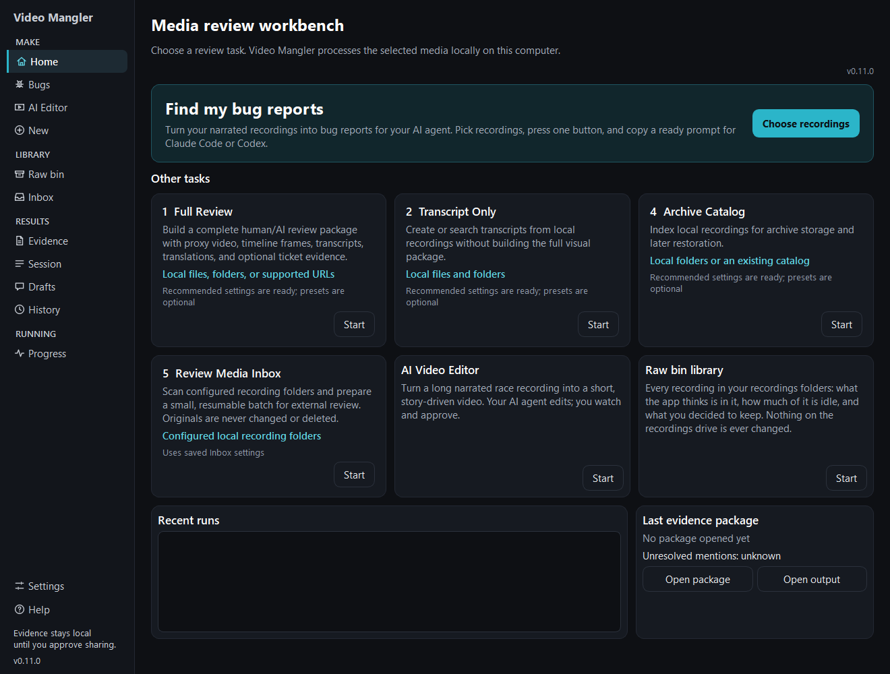

# Media Manglers

**Mangle yer media.** A Windows app that turns long, narrated recordings into
transcripts, screenshots, clips, packages and edited videos that you *and* your
AI agent can work with.

**[Download (coming soon)](#download-and-documentation)** ·
**[Documentation](docs/README.md)** ·
**[Report a bug or request a feature](https://github.com/Aintologic/media-manglers/issues)**

## What it does

Media Manglers turns long videos into things you and your AI agent can work with.
Everything runs **locally on your PC**. Your recordings are **only read, never
changed**, and nothing leaves your computer unless you turn on an AI mode.

The **Video Mangler Workbench** has four features on one engine:

- **Package any video for AI** (*working*). Any video, a file or a web link,
  racing or not: screenshots, a transcript and clips in a package an AI can
  review, even when the video itself is too big to upload.
- **Find my bug reports** (*working*). Narrate bugs while you use your software,
  press one button, and paste a ready prompt into Claude Code or Codex. Your agent
  reads the package on your PC, drafts the issues, and opens them only after you
  approve.
- **Watch the raw bin** (*working*). A library of every recording in your
  recordings folders: what is in each one, how much is idle, and what you
  decided to keep. The Review Media Inbox reviews new recordings and remembers
  which are done. The app only marks; it never moves or deletes a recording.
- **AI Video Editor** (*working*). Turn a long race recording into a
  story-driven video ready for YouTube. Your AI agent edits; you watch each
  version, say what to change, and export the one you like. Your private
  camera areas are always blurred.

**The engine behind them:** it finds the audio track with your voice, writes
it down with Whisper, spells your own words your way, and leaves out lines
Whisper makes up. It then takes the screenshots and clips and builds the
package. A built-in player lets you double-click any recording to watch it
with its transcript following along and a waveform of every audio track. Also
included: searchable transcripts and catalogs of whole archive folders.

## Download and documentation

- **Download:** the first public release is coming soon. When it is published,
  get the `VideoManglerWorkbench` zip from [Releases](https://github.com/Aintologic/media-manglers/releases),
  extract the whole zip, and run `VideoManglerWorkbench.exe`.
- **Every feature in one guide:** the [feature guide](docs/workbench/FEATURE_GUIDE.md)
  says what each feature is for, how to start it, what you get, and its limits.
- **Documentation:** every guide, from [getting started](docs/workbench/GETTING_STARTED.md)
  to [troubleshooting](docs/workbench/TROUBLESHOOTING.md), is listed on the
  [documentation home](docs/README.md). The same guides open from **Help** inside the app.
- **What's new:** [v0.11.0 release notes](docs/release-notes/RELEASE_NOTES_v0.11.0.txt).
- **Quality testing:** [benchmark program](docs/benchmarks/BENCHMARK_PROGRAM.md).
- **Build it yourself:** [build and test from a fresh clone](tools/gui/README.md) on
  Windows 10 or 11.

## Support and feedback

Use [GitHub Issues](https://github.com/Aintologic/media-manglers/issues) for bugs
and feature requests. Include the version shown in the bottom-left of the
Workbench. Please do not post private recordings, credentials or confidential output.

## Why it exists

Media Manglers started as a way to review sim-racing footage with AI, then grew
a way to turn bugs you mention out loud into ready-to-file reports. It was built
by describing what it should do to AI and testing every step, with no
traditional programming background required. That's the AÏntologic idea:
describe it, build it.

## License

Free to download is not the same as "do anything you like". In short:

- **Code, documentation text and screenshots**: GNU **AGPL-3.0-or-later**.
  See [`LICENSE`](LICENSE).
- **Third-party parts** that the packaged Workbench bundles (Qt for Python, the
  FFmpeg libraries inside Qt, the Python runtime and others): their **own
  licenses**. See [`THIRD_PARTY_NOTICES.txt`](THIRD_PARTY_NOTICES.txt) and the
  [`licenses`](licenses/) folder.
- **Names and logos**: the AÏntologic name and logos; the Media Manglers,
  Video Mangler, Audio Mangler and Video Mangler Workbench names; and the app
  icons in [`assets/`](assets/) are **not** covered by the AGPL. See
  [`TRADEMARKS.md`](TRADEMARKS.md).

Copyright 2026 Media Manglers Contributors.
