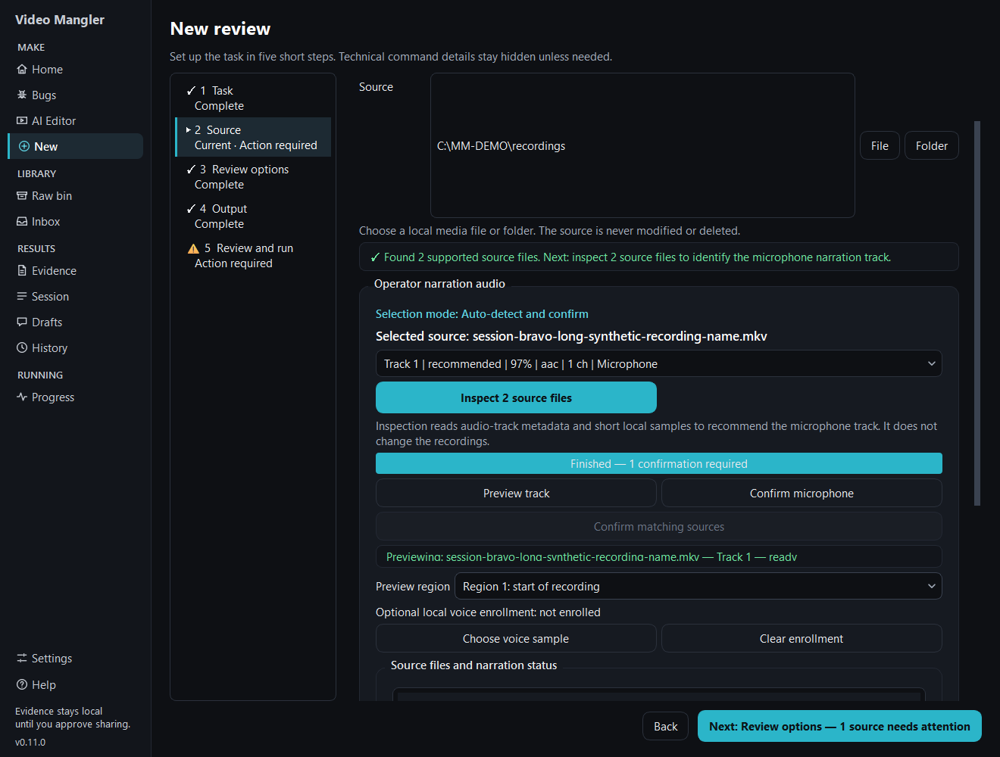
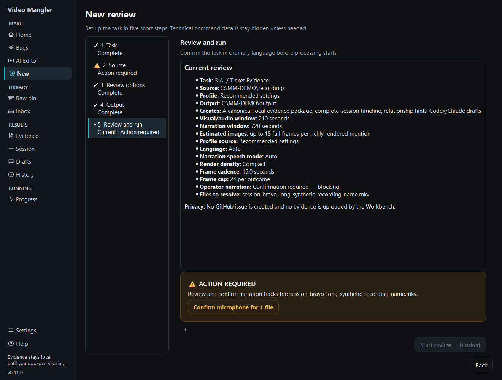
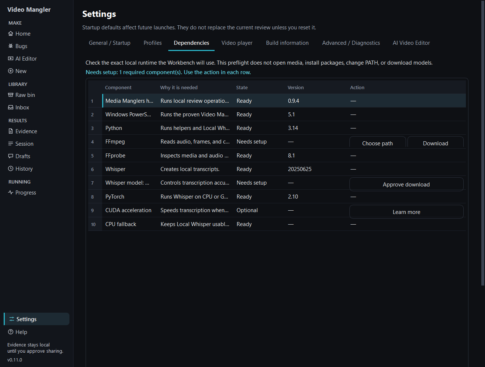
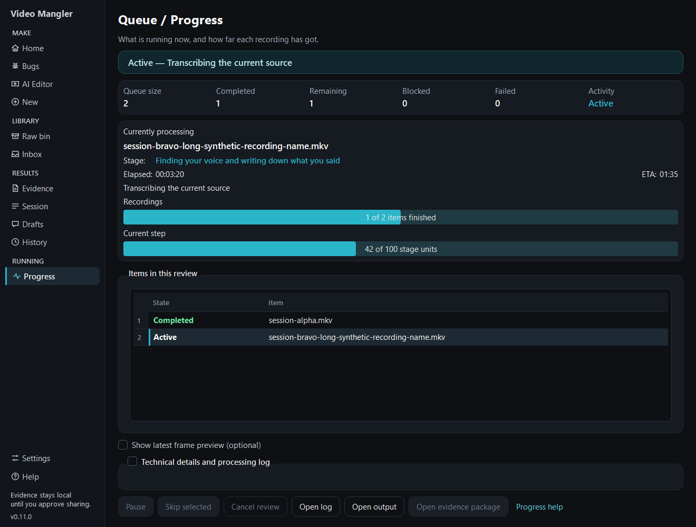

# AI / Ticket Evidence

This workflow prepares local evidence and draft material. It does not create a
GitHub issue, upload evidence, or decide the final ticket scope.

## 1. Choose the workflow and source

Choose **3 AI / Ticket Evidence**, open **New Review**, and select the folder or
recording.

**Expected:** before audio inspection, the Source page reports the number of
supported files and shows one primary **Inspect N source files** action.

## 2. Inspect narration tracks

Choose **Inspect N source files**. Inspection reads metadata and short local
samples; it does not modify the recordings. You can cancel safely.

**Expected:** completed results move into view and keyboard focus moves to the
compact source list.

## 3. Preview and confirm each microphone

1. Select a source row. That row is the authoritative source context.
2. Read its recommendation, confidence, selected narration, reason, and state.
3. Choose **Preview track**. The [built-in player](REVIEW_PLAYER.md) opens on
   that track at the **Preview region** and plays the whole recording, at full
   quality. **Next speech** and **Previous speech** jump between the speech it
   found, and its waveforms show every track.
4. Check the persistent `Previewing: source — Track N` identity. It says
   `ready` once the player is really playing that track.
5. Change the track only when needed, then choose **Confirm microphone**.

**Expected:** choosing another row or track pauses the player and the identity
says `preview not loaded` until you choose **Preview track** again; the next
preview replaces what the player was showing. A recommendation is advice;
confirmation applies only to the displayed source and track.

> **Required action:** `⚠ REQUIRED` means that source still needs a successful
> inspection or microphone confirmation.

## 4. Complete Review options and Output

Keep the recommended settings or choose an optional preset, then a separate
output folder. The source remains read-only. Local paths and media stay out of
GitHub.

## 5. Resolve Review and run blockers

If one source remains unresolved, the page names it and offers a dominant
**Confirm microphone for 1 file** action. Use that action to return directly to
the correct source.

**Expected:** blocked state shows `✕` or `⚠` text and **Start review — blocked**
is visibly neutral/disabled. When everything is ready, it changes to green
**✓ Start review**.

## 6. Let readiness check automatically

The Workbench checks readiness at launch. Open **Settings > Dependencies** only
when it names a repair, or use **Refresh readiness** after changing a tool. The
check does not open media, install software, change PATH, or download a model. A
model download always requires separate explained approval.

## 7. Follow progress

Start the review and open **Queue / Progress**.

**Expected:** only real source names appear. Source state remains `Active`
through transcription, consolidation, rendering, and packaging; only final
success becomes `Completed`.

## 8. Interpret the result

- **Success:** every required artifact exists and integrity reports `PASS`.
- **Cancellation:** the active item becomes `Cancelled`, finished items remain
  `Completed`, remaining becomes `0`, and ETA becomes `Unavailable`.
- **Saved layout:** after relaunch, an exact recorder-layout match can restore
  the confirmed track, but the selection remains editable.
- **Integrity failed:** do not treat the package as complete. Keep the output,
  open [Troubleshooting](TROUBLESHOOTING.md#evidence-integrity-failed), and retry
  only after the cause is corrected.

[Previous: Transcript Only](TRANSCRIPT_ONLY.md) · [Back to Help](README.md) · [Next: Archive Catalog](ARCHIVE_CATALOG.md)
