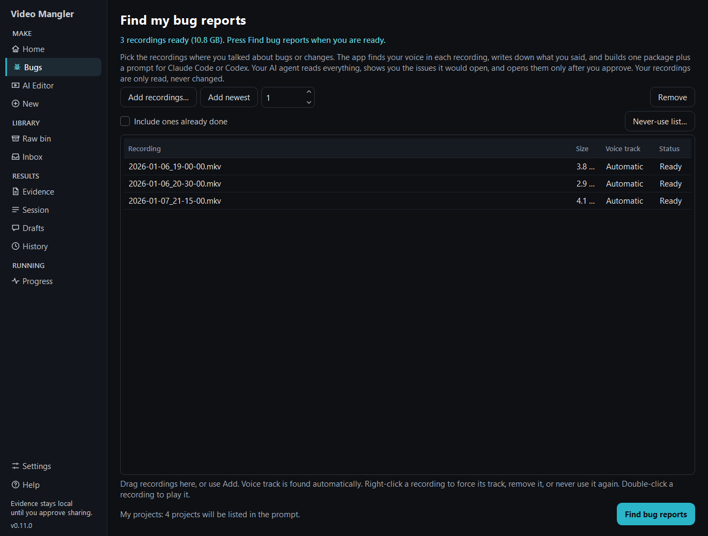
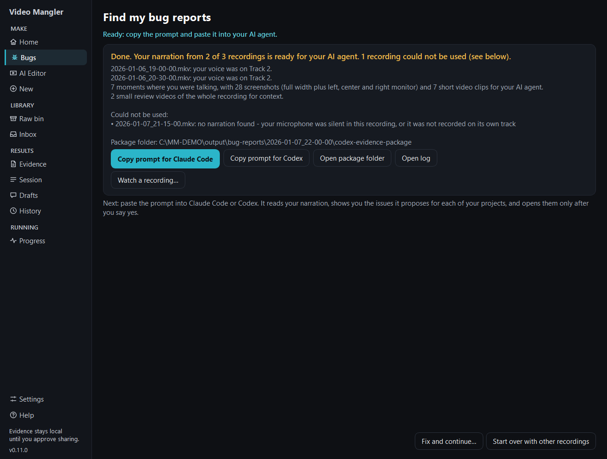

# Find my bug reports

Turn recordings where you talked about bugs, fixes and features into one
package plus a ready prompt for Claude Code or Codex. Your AI agent reads what
you said, shows you the issues it would open in each of your projects, and
opens them only after you approve.

Your recordings are only read. Nothing is uploaded, and nothing is written next
to your recordings.

## 1. Choose recordings

On **Home**, choose **Choose recordings** (or **Bugs** in the left rail).

- **Add recordings…** opens a file picker; select as many as you like.
- **Add newest** adds the newest recordings from your recordings folder.
- You can also drag recordings from Explorer onto the list.
- Double-click a recording to play it, here and in the list shown while the
  run is going. Right-click also offers **Play** and **Play with**; see
  [the built-in player](REVIEW_PLAYER.md).
- Right-click a recording to force its voice track, remove it from the list,
  or choose **Never use this recording**. Recordings on the never-use list are
  left out from then on; **Never-use list…** shows them and lets you allow one
  again. Double-click a recording in that list to watch it before you decide.
  The recordings themselves are never changed.
- **Add newest** leaves out recordings you already turned into a package and
  recordings on your never-use list. Tick **Include ones already done** to add
  them anyway. A recording identical to one already done (the same content,
  in another folder) counts as done too; never-use stays with the copy you
  marked. Both lists are kept in the app's library, and the Raw bin shows
  which recordings this feature has mined.
- If the library cannot be opened when Workbench starts, Workbench says so
  once, with the reason. That session the two lists are not shown, so before
  **Add newest**, **Add recordings…** or dropped files add anything, the page
  asks first: some of them may already be done or on your never-use list.
  Nothing is lost; the lists come back at the next start that opens the
  library.

Before the run starts, any recording longer than two hours is listed with its
length. Sessions left running are often long and mostly idle, so you can
**Leave them out** or **Include them**.

## 2. Press Find bug reports

There is no microphone step. For every recording the app finds the track with
your voice, in this order, and the track it shows says which one decided it:

1. **From track name.** If you name your audio tracks in OBS, OBS saves the
   names in the recording (VLC shows them too). A track whose name contains
   *narration* is your voice, whatever else its name says (so
   *T2 - Narration / Discord* is your voice). Otherwise a track whose name
   contains *music*, *game*, *simulator*, *spotter*, *engineer*, *system*,
   *discord* or *voice chat* is never your voice. A track named *full mix* is used only when no other
   track qualifies. Case does not matter. OBS's own names (*Track1*, *Track2*,
   and so on) are not names for this purpose.
2. **From your setting.** For a recording whose tracks have no names, Settings
   > **General / Startup** > **Narration track, for recordings without track
   names** gives each of Tracks 1 to 6 **Auto**, **Narration**, **Never
   narration**, **Game audio** (never your voice) or **Full mix** (used only
   when no other track qualifies, like a track named *full mix*). Every track
   starts on Auto.
3. **Auto-detected.** Otherwise the app listens to each audio track and picks
   the one with your voice. Tracks set to Never narration are left out.

When a track is named or set as your narration track but has no clear speech in
a recording, that recording is reported as **No narration found**; no other
track is used instead.

- If no track carries your voice, the recording is reported as **No
  narration found**, with what the app did hear: for example, that your usual
  microphone track is silent and the only words were a little game audio. It
  never makes up an empty or invented transcript.
- If there is speech but the app cannot tell which track is you, it says so and
  asks you to choose (see the end of this page). That happens, for example, when
  your voice is on a track that also carries game sound, such as a track that
  records everything. A recording full of speech is never called silent.

Only if you want to force a track: right-click the recording and choose
**Always use Track N**. That is your answer for that recording: it is remembered, it
shows as **Track N (you chose)** the next time you add the recording, and the Inbox, the
New Review wizard and the AI Video Editor use the same track. **Find my voice automatically**
clears it, and the app decides again. If the app has already heard your voice on another
track, the row says so in one calm line: *You chose Track 3. The app heard your voice on
Track 2. Your choice is used.*

A recording the app already knows goes straight to writing down what you said, without
**Finding your voice**. It still has to read the narration, so it is not much faster. When
two tracks tie, the tie-breaker is your saved answer for that recording's own track layout.

While it runs, **Show full progress** (or **Progress** in the left rail) shows
the same detail as any other review: each recording in the queue, the current
stage, the live log and the latest screenshot. Every run is listed in
**History** with its log.

While it runs you can also:

- **Skip selected** (or right-click, **Skip this recording**): skip any
  recording, including the one being worked on. Its work stops at once, it is
  marked **Skipped by you**, and nothing from it goes into the package.
- **Pause**: the app stops using your PC's processor and graphics card (for a
  game, say) until you press **Resume**; it then carries on where it was.
  Graphics memory already in use stays reserved while paused.
- **Stop**: ends the run. The list comes back with **Continue**, which picks up
  in the same package folder and reuses everything already finished
  (transcripts, voice tracks, screenshots, clips and review videos). This also
  works after closing the Workbench. **Start a new package instead** forgets
  the stopped run.

Runs use **below-normal priority** by default, so the programs you are using
stay fast (Settings > Diagnostics > *Run in the background*).

The run uses your Settings (folders, tools, Whisper model). It only switches
on the racing evidence options, and it writes a dated folder under your output
folder: `bug-reports\<date_time>`.

## What the package contains

For every stretch where you were talking:

- screenshots from a few seconds before you start to a few seconds after you
  stop, as the full width plus one picture per monitor
  (`left_monitor`, `center_monitor`, `right_monitor`);
- a short video clip with your voice.

Each recording also gets a small review video of the whole session, for context
between those moments. `NARRATION_EVIDENCE.md` in the package lists them all.
The review video is made on the graphics card while Whisper writes your
narration down, so it adds little to the run.

### Words to spell right

Settings > **General / Startup** > **Words to spell right** is one list, one
word or name per line, that Whisper is given as the words you use: your
product names, corner names, team mates. It starts with *iRacing*, *SimHub*
and *Crew Chief*. If Whisper keeps writing a word wrong, add what it writes
after an equals sign, for example `Brooklands=brook lands`; the transcript is
then corrected, and the player still shows what Whisper wrote. The list belongs
to you, not to a profile. Full Review, Transcript Only and Review Media Inbox use
the same list.

A line is also left out when your microphone track was nearly silent at that
moment: those are words Whisper made up over a quiet stretch, not yours.

### Only what you actually asked for

- **A ticket needs a request.** "Create a ticket", "make a ticket for…", "open an
  issue", "instructions for AI", or *Ticket.* said as a heading at the start of
  a sentence. A word like *ticket*, *bug*, *issue*, *broken* or *fix this* said
  in passing is not a ticket. It is never hidden either: those moments are in
  `MENTIONED_NOT_ASKED.md`, and the prompt tells your agent to show you that
  list with its proposals so you decide. It never files one on its own.
- **Lines the transcriber invents are left out**, in every transcription mode:
  stock phrases such as "Thanks for watching!", and one phrase said over and over
  ("a sample phrase, a sample phrase, a sample phrase").
- **Sound from your other tracks is not counted as you.** When the recording has a
  music, game, spotter or voice-chat track (by its name, or set to Never narration),
  a line that was written down from faint sound reaching your microphone while
  that track was loud, or that the other track says word for word, is left out.
  The full mix is never compared, because it carries your voice too.
- Every line left out is listed with the reason in the transcript's
  `filtered_segments` (`transcript\sources\*.transcript.raw.json`), and the
  built-in player shows it, so you can check nothing real was dropped.

## 3. Copy the prompt

The run ends on the results screen:

- **Copy prompt for Claude Code** or **Copy prompt for Codex**, then paste it
  into that agent. The prompt contains the package's real folder path and your
  project list, so it works as pasted.
- **Open package folder** shows the package itself.
- **Watch a recording…** lists this run's recordings so you can play one. In
  [the built-in player](REVIEW_PLAYER.md) you read what was written down for
  it, line by line, while you watch.
- The line under it says when the waveforms are ready: the run's recordings
  are measured in the background, one at a time, so the player shows every
  track's waveform at once. It reads, for example,
  `Building the waveforms for the player (1 of 3)…` and then
  `Waveforms ready for 3 of 3 recordings.` Starting another run stops it, and
  it carries on later.

A recording with no narration is a normal result, not a problem: the run still
ends as **Done**, for example *Done. 2 of 3 recordings had narration; 1 had
none, so nothing to report from it.*, and the results list it under **No
narration, so nothing to report** with what was heard.

If a recording could not be used, the results screen names it and says why,
and the run ends as completed with problems. The other recordings are still
packaged.

If the Whisper speech model on your PC is damaged, or your graphics card could
not be used so speech is written down on the much slower processor, the page
says so in plain words while the run is going, with how to fix it.

When the app cannot tell which track is your
voice (two tracks carry different voices, or the speech is only on tracks that
also carry other sound) it does not guess: press **Fix and continue…**,
right-click that recording, choose its track and press **Continue**. That
recording is then transcribed from the track you chose, and the others are
still listened to as usual. Its package says the recording is waiting for your
choice, so your AI agent does not take it for one with nothing in it.

## My projects

The prompt lists your projects from your private project map (Settings >
Advanced > repo map). It stays on this computer and is never committed or
uploaded. Without it, your agent asks which repository each issue belongs to.

[Back to Help](README.md)
