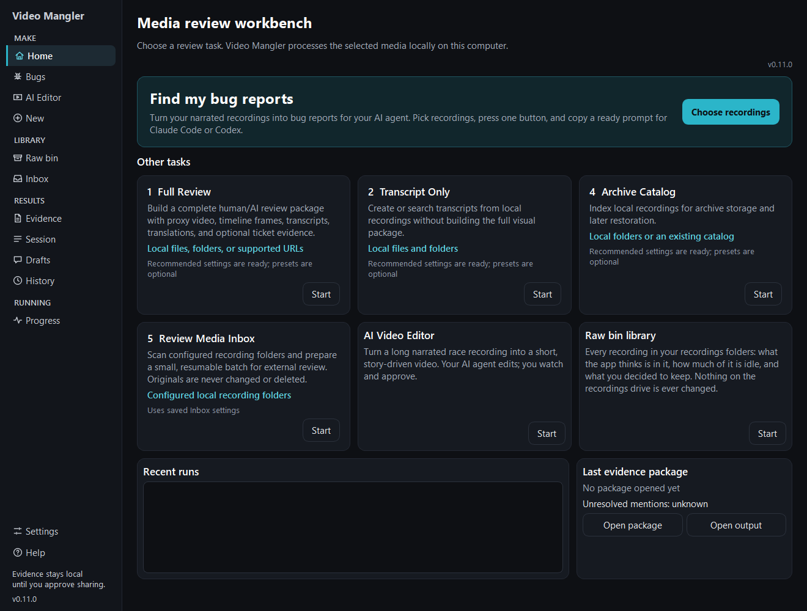

# Getting started

## Download and open the Workbench

1. Open the [Media Manglers releases page](https://github.com/Aintologic/media-manglers/releases).
2. Download `VideoManglerWorkbench-vX.Y.Z-windows-x64.zip` and extract the entire folder.
3. Launch `VideoManglerWorkbench.exe` from that folder. Do not copy only the
   executable away from its Help, engine, and runtime sidecars.
4. Let the Workbench check readiness automatically. Open **Settings >
   Dependencies** only when it names a repair or update action.

The Workbench reads source media without modifying it. New review artifacts are
written only under the output folder you select.

## 1. Choose a task

To turn narrated recordings into bug reports for your AI agent, use the big
**Find my bug reports** tile on Home. It is one screen: choose recordings,
press **Find bug reports**, copy the prompt. See
[Find my bug reports](FIND_BUG_REPORTS.md).

For other work, choose one of the task cards under **Other tasks**. **1 Full
Review** is the general-purpose starting point.

**5 Review Media Inbox** opens its dedicated dashboard instead of the general
five-step wizard. Choose **Next 3**, **Up to N**, or **All pending**, then select
**Process new media**. The same page reconciles existing work, prepares compact
local evidence, and recognizes stable external returns. When review work is
ready, use **Open Codex review queue** or **Copy Codex prompt**. The only normal
interruptions are a genuinely ambiguous microphone-track choice and one
aggregate generated-evidence cleanup decision.

**Expected:** the selected task appears in the Workbench header and in step 1.

## 2. Complete the five steps

Open **New Review** and work from top to bottom:

1. **Task** — confirm what the review will create.
2. **Source** — choose a recording or folder. Full Review also accepts multiple
   web-video URLs, one per line. AI / Ticket Evidence immediately shows the
   supported-file count and the required **Inspect N source files** action.
3. **Review options** — keep the recommended settings, or choose an optional
   preset whose plain-language purpose matches the review.
4. **Output** — choose where the new local results will be written. If the
   folder cannot be used (on your recordings drive, or in a temporary folder,
   say), the reason shows in red right under the field as soon as you type,
   browse or pick it.
5. **Review and run** — resolve any named blocker, then choose the green
   **Start review** action.

The step list uses text and icons as well as color: `✓ Complete`, `⚠ Action
required`, and `✕ Blocked`.

> **Required action:** A disabled **Start review — blocked** button is not a
> dead control. Read the blocker panel immediately above it and use its single
> dominant correction action.

## 3. Watch progress and open results

**Queue / Progress** shows real source filenames, the active stage, elapsed
time, ETA state, and terminal item states. `Completed` is final and never
returns to `Active`.

When processing settles, read the result sentence and choose **Open output** or
**Open evidence package**.

[Previous: Help landing](README.md) · [Back to Help](README.md) · [Next: Codex Evidence](CODEX_EVIDENCE.md)
