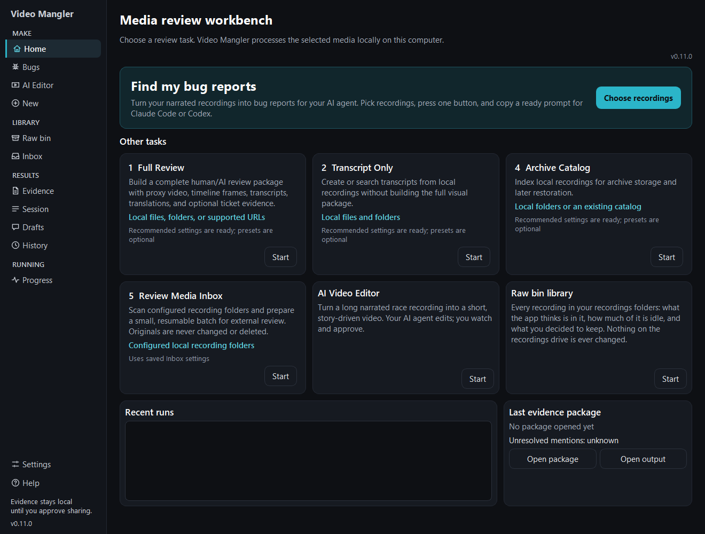

# Media Manglers Workbench Help

Use this guide while operating the Workbench. It explains what to click, what
you should see, and what to do when a review cannot continue. Original media is
read-only; review output stays in the local folder you choose.

## Start here

**[Find my bug reports](FIND_BUG_REPORTS.md)** turns your narrated recordings
into a package and a ready prompt for Claude Code or Codex. It is the big tile
on Home.

**[Getting started](GETTING_STARTED.md)** covers installing and the other tasks.

**[Every feature in one guide](FEATURE_GUIDE.md)** says what each feature is
for, how to start it, what you get, and its limits.

## Choose your task

| Task | Use it when |
| --- | --- |
| [Full Review](FULL_REVIEW.md) | You want the complete proxy, frame, transcript, translation, and add-on flow. |
| [Transcript Only](TRANSCRIPT_ONLY.md) | You need transcripts or literal transcript search without a full media review. |
| [AI / Ticket Evidence](CODEX_EVIDENCE.md) | You want a local evidence package and draft material for later human review. |
| [Archive Catalog](ARCHIVE_CATALOG.md) | You need a searchable local catalog or archive preparation. |
| [Review Media Inbox](REVIEW_NEW_VIDEOS.md) | You want one-click, bounded, resumable local preparation and a queue for later external Codex review. |
| [Raw bin library](RAW_BIN_LIBRARY.md) | You want to see every recording on your raw drive, what is in it, how much is idle, and mark what to keep. |

## Common tasks

- [Project documentation home](../README.md)
- [Dependencies and setup](DEPENDENCIES_SETUP.md)
- [Progress and results](PROGRESS_RESULTS.md)
- [Watch a recording in the built-in player](REVIEW_PLAYER.md)
- [Look through a package on Evidence and Session Review](#evidence-and-session-review)
- [Make a race video with the AI Video Editor](AI_VIDEO_EDITOR.md)
- [Settings and migration](SETTINGS_MIGRATION.md)
- [Troubleshooting by what you see](TROUBLESHOOTING.md)
- [Technical reference / developer documentation](TECHNICAL_REFERENCE.md)

## Evidence and Session Review

**Evidence** opens one package a review made and shows what it found. Choose
the package folder; the list on the left then holds:

- each bug report, with `[lightweight]` for one that was found but not given
  screenshots and clips, and `[review needed]` for a moment the run could not
  decide about;
- after them, one `[clips]` row for each recording that has clips or a small
  review copy, so they can be played even from a package with no bug reports.

Select a bug report to read it and see its files: drafts, screenshots, and the
small review copy and clips of its recording that overlap it. Select a
`[clips]` row to see that recording's small review copy and every clip, for
example `Small review copy: <name>` and `Clip 3 (0:12:34): <name>`, or
`Clip 3 (0:12:34) part 2 of 3: <name>` when a long moment was cut into parts. **Rebuild evidence**,
**Export drafts**, **Open evidence folder** and **Play this moment** work on a
bug report, so they are greyed out for a `[clips]` row.

Double-click a file to open it. A clip or the small review copy plays in your
chosen player; the small review copy plays standing in for its recording, so
[the built-in player](REVIEW_PLAYER.md) shows the recording's transcript and
moments with it. A file marked `[missing]` is not where the package says;
double-clicking it opens the folder it should be in.

**Session Review** shows the whole session of the same package: the
**Complete timeline** of every mention, with its time, type and evidence
status, the **Proposed ticket threads** and the **Unassigned mentions**.
**Play this moment**, double-click or right-click plays the moment you
selected. Relationship hints are suggestions; you, Codex or Claude decide what
belongs to one ticket.

The packaged copy contains every page and image for offline use. **Open
exact-build online Help** uses the full Git commit embedded in the executable,
so the online page always matches the installed build rather than whichever
documentation happens to be newest on `main`.

[Next: Getting started](GETTING_STARTED.md)
